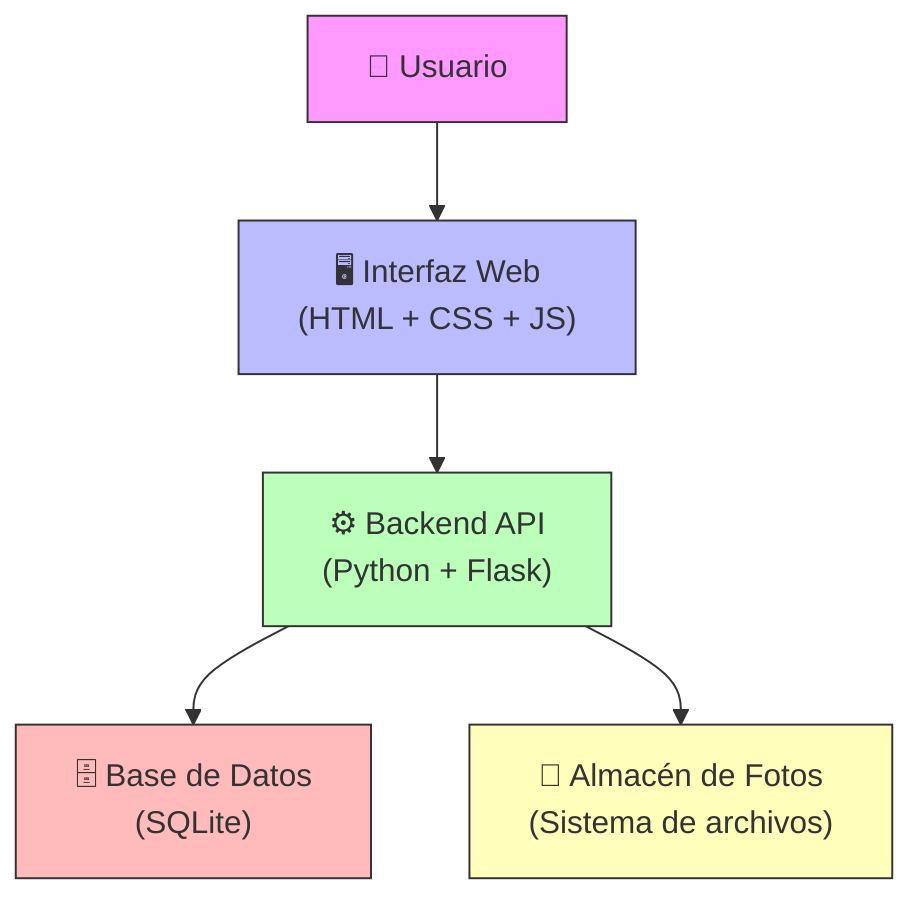
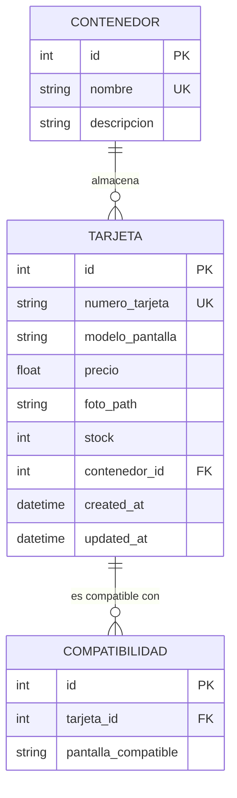
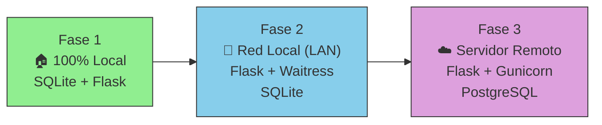

# 📋 Propuesta Técnica — Gestor de Tarjetas de Pantallas

**Proyecto:** ComPaye Tarjetas  
**Fecha:** 24 de noviembre de 2026  
**Objetivo:** Sistema de inventario digital para tarjetas de pantallas de un negocio de electrónica.

---

## 1. Contexto y Problema

Actualmente la búsqueda de tarjetas de pantallas se hace de forma **física y manual**, lo que resulta agotante y propenso a errores. Se necesita un sistema digital que permita registrar, buscar y gestionar el inventario de tarjetas desde un solo lugar.

### Restricciones del Entorno

| Restricción | Detalle |
|---|---|
| 💻 Equipo | Computadora de **bajos recursos** |
| 🌐 Conectividad | **Sin internet la mayor parte del tiempo** |
| 📦 Despliegue | Debe funcionar **100% local**, con opción futura de subir a servidor |

---

## 2. Requerimientos Funcionales

### 2.1 Gestión de Tarjetas (CRUD)
- **Crear** una tarjeta con toda su información.
- **Leer / Buscar** tarjetas por cualquiera de sus campos.
- **Actualizar** datos de una tarjeta existente.
- **Eliminar** tarjetas del inventario.

### 2.2 Campos de cada Tarjeta

| Campo | Tipo | Descripción |
|---|---|---|
| `numero_tarjeta` | Texto / Código | Identificador único de la tarjeta (puede incluir letras y números) |
| `modelo_pantalla` | Texto | Modelo de la pantalla a la que pertenece |
| `compatibilidad` | Lista de textos | Pantallas con las que es compatible (relación uno-a-muchos) |
| `precio` | Número decimal | Precio de venta o costo |
| `foto` | Imagen (archivo) | Fotografía de la tarjeta |
| `stock` | Número entero | Cantidad disponible en inventario |
| `contenedor` | Texto | Ubicación física donde se guardó (ej: "Caja A-3", "Estante 2") |

### 2.3 Búsqueda y Filtrado
- Filtros combinados: por contenedor, rango de precio, stock disponible.
- Resultados con vista de **tabla** y vista de **tarjetas con foto**.

### 2.4 Gestión de Stock
- Incrementar/decrementar stock rápidamente.
- Alerta visual cuando el stock sea **0** (agotado).

### 2.5 Gestión de Contenedores
- Catálogo de contenedores (cajas, estantes, etc.).
- Ver qué tarjetas hay dentro de cada contenedor.

### 2.6 Fotos
- Subir una foto por tarjeta (desde archivo o cámara del dispositivo).
- Mostrar miniatura en listados, foto completa en detalle.
- Las fotos se almacenan **localmente** en disco.

---

## 3. Requerimientos No Funcionales

| Requisito | Detalle |
|---|---|
| **Rendimiento** | Debe correr fluido en equipos con ≤ 4 GB RAM |
| **Offline-first** | Funcionar 100% sin internet |
| **Portabilidad** | Base de datos en un solo archivo, fácil de respaldar/copiar |
| **Escalabilidad** | Poder migrar a un servidor sin reescribir la app |
| **Usabilidad** | Interfaz sencilla, intuitiva, sin curva de aprendizaje alta |
| **Respaldo** | Poder exportar/importar la base de datos fácilmente (copia del archivo) |

---

## 4. Stack Tecnológico Recomendado

> [!IMPORTANT]
> El stack se elige priorizando: **bajo consumo de recursos**, **funcionamiento offline**, y **posibilidad de migrar a servidor** sin reescribir.

### 4.1 Arquitectura General



### 4.2 Desglose del Stack

| Capa | Tecnología | ¿Por qué? |
|---|---|---|
| **Backend** | **Python 3 + Flask** | Ligero, fácil de aprender, se ejecuta con mínimos recursos. Flask es micro-framework: solo carga lo que necesitas. |
| **Base de datos** | **SQLite** | Archivo único (`.db`), sin servidor de BD, 0 configuración, perfecto para offline. Se puede migrar a PostgreSQL/MySQL después. |
| **ORM** | **SQLAlchemy** (opcional) | Abstrae SQL, facilita migración futura a otro motor de BD. |
| **Frontend** | **HTML + CSS + JavaScript vanilla** | Sin frameworks pesados (React/Vue). Carga rápido, sin dependencias externas. |
| **CSS Framework** | **PicoCSS** o **MVP.css** | CSS minimalista (~10 KB), da diseño limpio sin escribir CSS desde cero. No requiere CDN, se incluye localmente. |
| **Fotos** | **Sistema de archivos local** | Las imágenes se guardan en una carpeta del proyecto, referenciadas en la BD por ruta. |
| **Servidor local** | **Flask dev server** o **Waitress** | Waitress es un servidor WSGI para Windows, ligero y sin dependencias C. |

### 4.3 ¿Por qué NO otras tecnologías?

| Descartada | Razón |
|---|---|
| React / Vue / Angular | Demasiado pesado para el equipo, requiere Node.js, build tools, etc. |
| Django | Más pesado que Flask para un proyecto de este tamaño. |
| MongoDB | Requiere servidor corriendo, más RAM. SQLite es archivo puro. |
| Electron / Tauri | Empaquetado de app de escritorio complica despliegue y consume más recursos. |
| Node.js + Express | Viable, pero Python + Flask es más accesible si el equipo no tiene experiencia en JS backend. |

---

## 5. Estructura del Proyecto

```
compaye-tarjetas/
├── app.py                  # Punto de entrada de la aplicación Flask
├── config.py               # Configuración (ruta de BD, carpeta de fotos, etc.)
├── requirements.txt        # Dependencias de Python
│
├── models/                 # Modelos de datos (SQLAlchemy)
│   ├── __init__.py
│   ├── tarjeta.py          # Modelo Tarjeta
│   └── contenedor.py       # Modelo Contenedor
│
├── routes/                 # Rutas / Endpoints
│   ├── __init__.py
│   ├── tarjetas.py         # CRUD de tarjetas
│   └── contenedores.py     # CRUD de contenedores
│
├── templates/              # Plantillas HTML (Jinja2)
│   ├── base.html           # Layout base
│   ├── index.html          # Página principal / buscador
│   ├── tarjeta_form.html   # Formulario crear/editar
│   ├── tarjeta_detail.html # Detalle de tarjeta
│   └── contenedores.html   # Listado de contenedores
│
├── static/                 # Archivos estáticos
│   ├── css/
│   │   └── style.css       # Estilos personalizados
│   ├── js/
│   │   └── app.js          # JavaScript (búsqueda, filtros, etc.)
│   └── img/                # Imágenes del sistema (logo, íconos)
│
├── uploads/                # 📸 Fotos de tarjetas (generada en runtime)
│   └── tarjetas/
│
└── database/
    └── compaye.db          # 🗄️ Base de datos SQLite (generada en runtime)
```

---

## 6. Modelo de Base de Datos



---

## 7. Plan de Migración a Servidor

Cuando haya internet estable y se quiera usar en red:



| Fase | Qué cambia | Esfuerzo |
|---|---|---|
| **Fase 1 → 2** | Cambiar `host='127.0.0.1'` por `host='0.0.0.0'` para que otros equipos en la red accedan. | ⭐ Mínimo (1 línea) |
| **Fase 2 → 3** | Cambiar SQLite por PostgreSQL en `config.py`, desplegar en VPS con Gunicorn + Nginx. | ⭐⭐ Medio (configuración) |

> [!TIP]
> Si usas SQLAlchemy como ORM, el cambio de SQLite a PostgreSQL es solo modificar la cadena de conexión. El código no cambia.

---

## 8. Funcionalidades por Prioridad

### 🟢 MVP (Versión 1 — lo esencial)
- [ ] CRUD completo de tarjetas
- [ ] Búsqueda por número de tarjeta y modelo
- [ ] Subida de foto
- [ ] Gestión de stock (ver y editar cantidad)
- [ ] Asignar contenedor a tarjeta

### 🟡 Versión 2 (mejoras)
- [ ] Filtros avanzados combinados
- [ ] Vista de tarjetas con miniatura
- [ ] Gestión de contenedores (CRUD propio)
- [ ] Exportar inventario a CSV/Excel
- [ ] Alerta visual de stock agotado

### 🔵 Versión 3 (extras)
- [ ] Historial de cambios de precio/stock
- [ ] Lectura de código de barras / QR con cámara
- [ ] Dashboard con estadísticas (total tarjetas, valor del inventario, etc.)
- [ ] Multi-usuario con login básico
- [ ] Despliegue en servidor remoto

---

## 9. Dependencias de Python

```txt
Flask==3.1.0
SQLAlchemy==2.0.36
Flask-SQLAlchemy==3.1.1
Pillow==11.1.0        # Para redimensionar fotos y ahorrar espacio
Waitress==3.0.2       # Servidor WSGI para Windows (producción local)
```

> [!NOTE]
> Solo **5 paquetes**. La instalación completa pesa menos de **30 MB**. No se necesita Node.js ni ningún build tool.

---

## 10. Cómo Ejecutar (vista previa)

```bash
# 1. Crear entorno virtual
python -m venv venv
venv\Scripts\activate

# 2. Instalar dependencias
pip install -r requirements.txt

# 3. Ejecutar la aplicación
python app.py

# 4. Abrir en el navegador
# http://localhost:5000
```

---

## 11. Decisiones Pendientes

Antes de comenzar a programar, conviene definir:

| # | Pregunta | Opciones |
|---|---|---|
| 1 | ¿Qué formato tiene el **número de tarjeta**? | Numérico puro, alfanumérico, con guiones, etc. |
| 2 | ¿Se necesita **control de usuarios** (login) desde el inicio? | Sí / No (se puede agregar después) |
| 3 | ¿Las fotos se toman desde el **celular** o se suben desde la **PC**? | Esto define si la interfaz necesita acceso a la cámara. |
| 4 | ¿Cuántas tarjetas hay aproximadamente en el inventario? | 100, 500, 1000+... (para validar que SQLite es suficiente) |
| 5 | ¿Se quiere **modo oscuro** o diseño con colores del negocio? | Personalización visual. |

---

> [!IMPORTANT]
> **Próximo paso:** Una vez que definas las decisiones pendientes, puedo comenzar a generar el código del proyecto completo (modelos, rutas, plantillas y estilos) directamente en tu repositorio `compaye-tarjetas`.
